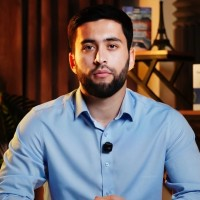
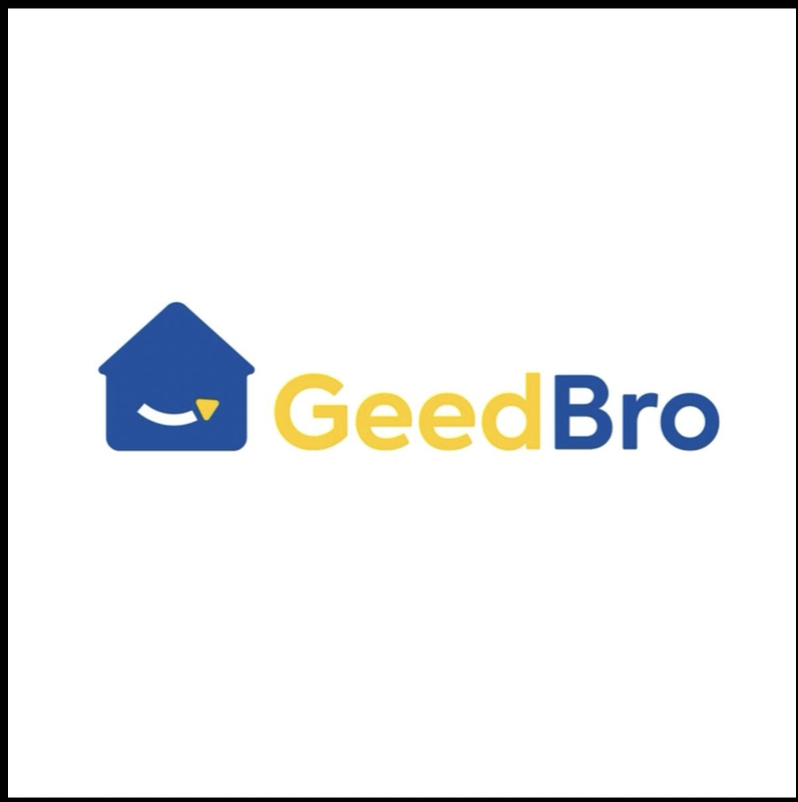
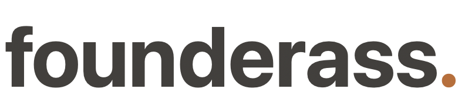
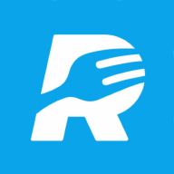
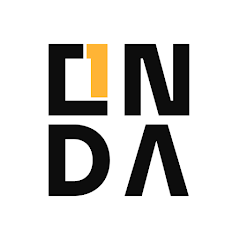
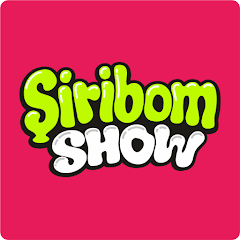
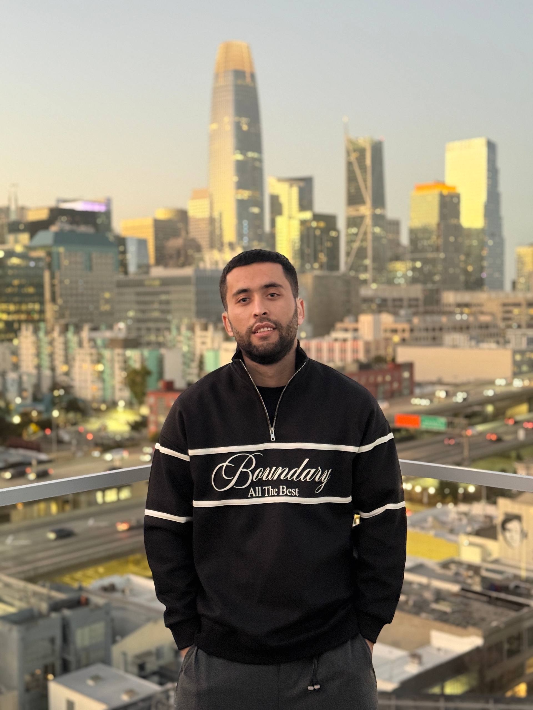
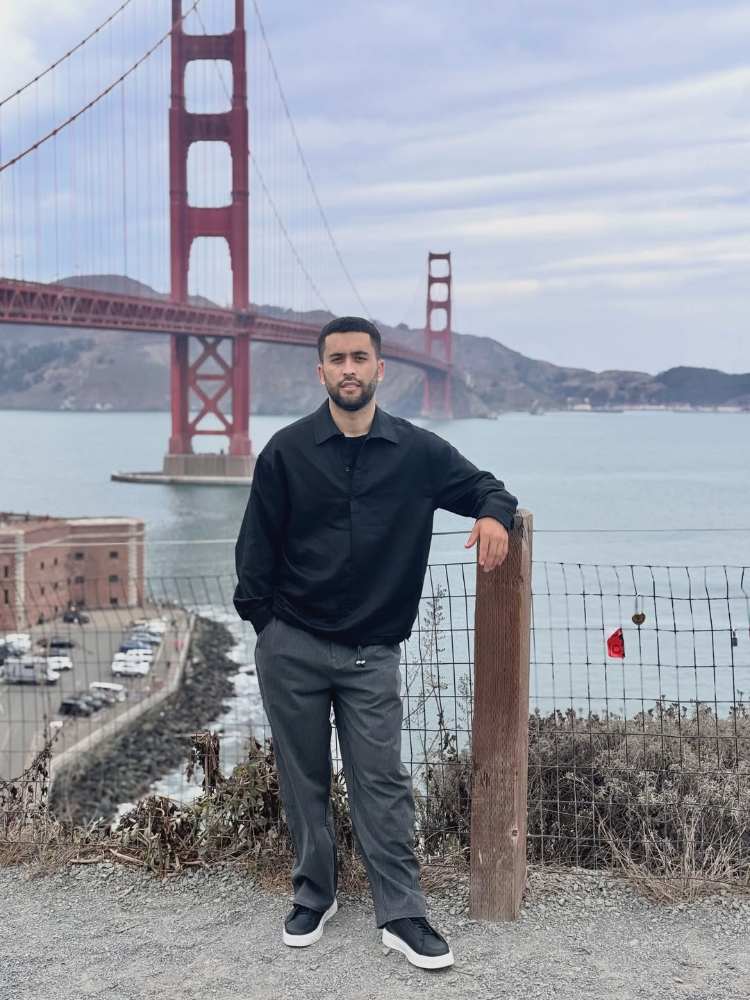

# Olamgir Rajabboev

**Founder · Product builder · AI-assisted web developer**

Founder & CEO of **GEEDBRO LLC**, a startup development and IT outsourcing company. Currently building [CAMVI](https://camvi.uz/), computer vision for retail analytics and employee attendance.

My background is in accounting, finance, and business operations. I turn everyday business problems into software — from restaurant operations and driving-test preparation to tools for startup founders.

📍 San Francisco Bay Area · Uzbekistan

[LinkedIn](https://www.linkedin.com/in/olamgir-rajabboev-bba743224/) · [Email](mailto:olamgirrajabboyev777@gmail.com) · [Full CV on Bold.pro](https://uz.bold.pro/my/olamgir-rajabboev-250202195049)

 

## Experience

| Where | Role | When | What |
| --- | --- | --- | --- |
|  **GEEDBRO LLC** | Founder & CEO | 2023 – now | Build startup products and lead IT outsourcing, with a current focus on CAMVI. Product strategy, team coordination, commercial delivery, and hands-on development. |
| **ZARBAZZAR LLC** | Co-founder | Feb 2026 – Sep 2026 | Jewelry and gold marketplace: business model, pricing analytics, auctions, and partnerships. |
| **TASTY PRODUCTION LLC** | Product Owner | Apr 2024 – Sep 2025 | Led Shiribom Show, connecting product purchases with QR-based promotions. Coordinated technical, marketing, and production teams. |
| **ONDA-INVESTORS** | CEO | Dec 2020 – Jan 2024 | Developed an Islamic-finance investment platform concept; led strategy, investor relationships, and risk-management planning. |
| **ONDA-INVESTOR LLC** | Shareholder & CEO | Dec 2020 – Jan 2024 | Built installment retail operations across finance, marketing, and customer experience. |
| **SMART AUDIT AT LLC** | Audit Assistant | Dec 2019 – Dec 2020 | Financial-statement reviews, internal controls, audit planning, and accounting-discrepancy analysis. |

## Selected products

| Product | My role | What it does |
| --- | --- | --- |
|  [**CAMVI**](https://camvi.uz/) | Founder & product lead, GEEDBRO LLC | Turns camera data into customer analytics and employee attendance insights for retail and HR teams. |
|  [**USDrive**](https://usdrive.uz/) | Independent creator & developer | Driving-test preparation for all 50 U.S. states and Washington, DC. Multilingual lessons, practice questions, document guidance, and DMV search. Built from scratch with AI-assisted coding. |
|  [**FounderAss**](https://founderass.com/) | Creator & product lead | Investor-discovery and fundraising workspace prototype: investor search, CRM, outreach planning, calendars, tasks, and document workflows. |
|  [**Restu**](https://restu.uz/) | Founder & contributing developer, GEEDBRO LLC | Restaurant management: QR ordering, point of sale, inventory, reporting, and staff order management. |
| **Finora** | Founder & product lead, GEEDBRO LLC | AI finance assistant concept with voice, text, and receipt input for expenses, debts, reminders, and reports. |

## More from my portfolio

| Project | Focus |
| --- | --- |
| **XBSavdo** | Footwear e-commerce. |
| **ONDA** | A marketplace for multiple product categories. |
| **ONDAInvest** | Investment-platform concept based on Islamic finance. |
|  **GeedBro rentals** | Short-term vacation-property rental marketplace. |
|  **ONDA B2B** | Business-to-business trade and collaboration tools. |
| **Apple Market · McBro Market** | Premium-electronics commerce projects. |
|  **Restu Waiter** | A companion app for restaurant staff to manage orders and service. |
|  **Shiribom Show** | A mobile app connecting product QR codes with shows and promotions. |

Other projects: **Lumioni** and **TicON**.

## Milestones & learning

- **CAMVI funding** — raised **$40,000 from Yoshlar Ventures**. [Founder interview](https://the-tech.media/en/p/kak-paren-iz-kashkadari-sozdal-it-startap-i-privlek-40-000-investiczij).
- **Alchemist Silkroad Startup Program** — selected to represent GEEDBRO / CAMVI in the **2026** program.
- **Cornell venture growth program** — participated in a four-day program in Tashkent with founders from the Yoshlar Ventures ecosystem. [My reflections](https://www.linkedin.com/posts/olamgir-rajabboev-bba743224_uzbekistan-startups-venturecapital-activity-7493626908081807360-zbLE).

## Education

| Institution | Program | When |
| --- | --- | --- |
| **Tashkent Financial Institute** | BSc in Accounting and Finance | Sep 2019 – Jun 2023 |
| **Karakul Academic Lyceum** | High School Diploma | Sep 2016 – May 2019 |
| **Najot Nur** | Public Speaking Course — “Most Diligent Orator” certificate | — |

## Skills & tools

**Business:** product strategy, startup development, financial analysis, auditing, market research, and team leadership.  
**Web:** JavaScript, TypeScript, React, Next.js, HTML, CSS.  
**Backend & data:** Node.js, Express, REST APIs, PostgreSQL, Redis.  
**Workflow:** Codex, Claude Code, Git, GitHub, Docker, and technical SEO.  
**Languages:** Uzbek (native), English (B1).

## Interviews & stories

- [**The Tech** — Building CAMVI and joining Alchemist](https://the-tech.kz/kak-paren-iz-uzbekistana-sozdal-ai-sistemu-dlya-biznesa-i-popal-v-amerikanskij-akselerator-alchemist)
- [**The Tech** — From Kashkadarya to a $40,000 investment](https://the-tech.media/en/p/kak-paren-iz-kashkadari-sozdal-it-startap-i-privlek-40-000-investiczij)
- [**Pivot** — Olamgir Rajabboev and the Restu startup](https://pivot.uz/a-revolution-in-the-restaurant-business-olamgir-rajabboev-and-the-restu-uz-startup/)

## In pictures

  
  

## Contact

[**olamgirrajabboyev777@gmail.com**](mailto:olamgirrajabboyev777@gmail.com) · [LinkedIn](https://www.linkedin.com/in/olamgir-rajabboev-bba743224/) · [Bold.pro](https://uz.bold.pro/my/olamgir-rajabboev-250202195049) · [CAMVI](https://camvi.uz/) · [FounderAss](https://founderass.com/)
