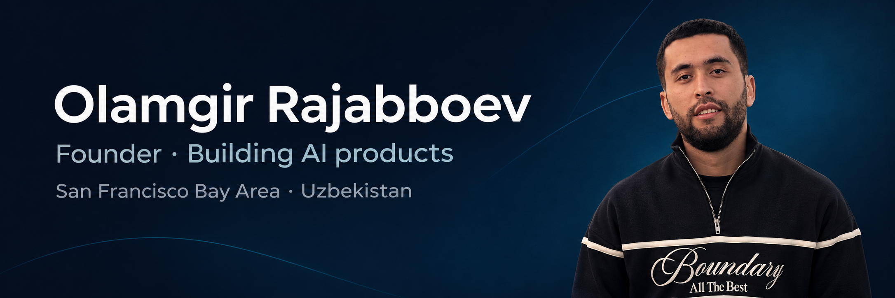
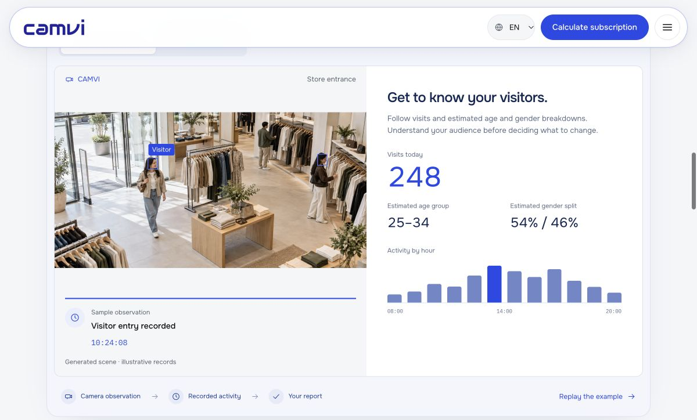
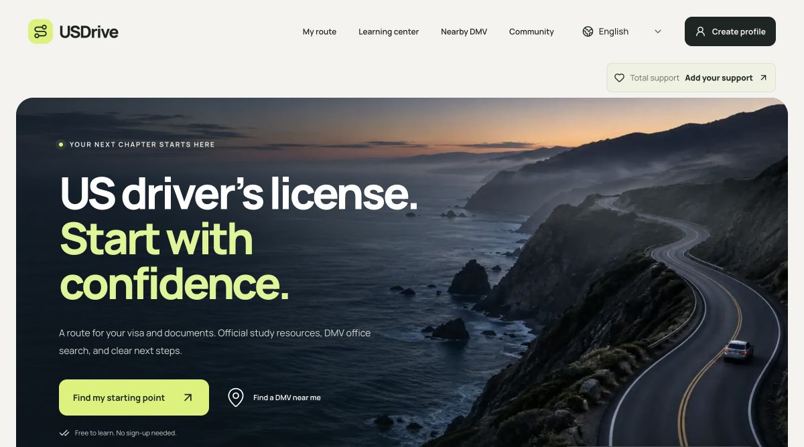
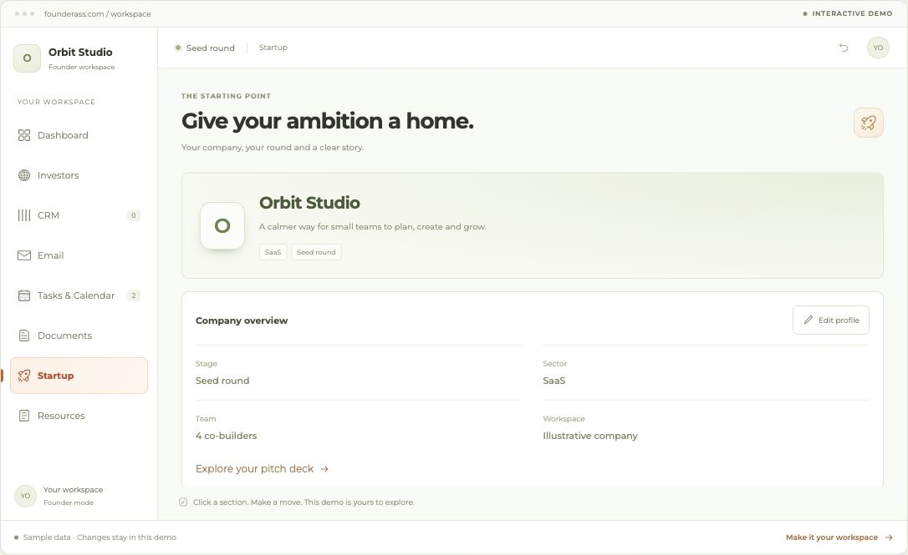
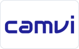
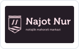

# Olamgir Rajabboev

**Founder · Building AI products**

Founder & CEO of **GEEDBRO LLC**, a startup development and IT outsourcing company. Currently building [CAMVI](https://camvi.uz/), computer vision for retail analytics and employee attendance.

My background is in accounting, finance, and business operations. I turn everyday business problems into software — from restaurant operations and driving-test preparation to tools for startup founders.

📍 San Francisco Bay Area · Uzbekistan

[LinkedIn](https://www.linkedin.com/in/olamgir-rajabboev-bba743224/) · [Email](mailto:olamgirrajabboyev777@gmail.com) · [Full CV on Bold.pro](https://uz.bold.pro/my/olamgir-rajabboev-250202195049)

[Product previews](#product-previews) · [Skills & tools](#skills--tools) · [Interviews & stories](#interviews--stories) · [Work with me](#work-with-me)

## Product previews

### CAMVI

Visitor analytics and employee attendance. <a href="https://camvi.uz/en#home-example">Explore the public demo →</a>

### USDrive

U.S. driving and license-preparation guides. <a href="https://usdrive.uz/">Visit USDrive →</a>

### FounderAss

Investor discovery and fundraising workflows. <a href="https://founderass.com/">Visit FounderAss →</a>

*Click a screenshot to enlarge it. CAMVI and FounderAss previews use illustrative data.*

## Experience

### GEEDBRO LLC

**Founder & CEO** · 2023 – now

Build startup products and lead IT outsourcing, with a current focus on CAMVI. Product strategy, team coordination, commercial delivery, and hands-on development.

### ZARBAZZAR LLC

**Co-founder** · Feb 2026 – Sep 2026

Jewelry and gold marketplace: business model, pricing analytics, auctions, and partnerships.

### TASTY PRODUCTION LLC

**Product Owner** · Apr 2024 – Sep 2025

Led Shiribom Show, connecting product purchases with QR-based promotions. Coordinated technical, marketing, and production teams.

### ONDA-INVESTORS

**CEO** · Dec 2020 – Jan 2024

Developed an Islamic-finance investment platform concept; led strategy, investor relationships, and risk-management planning.

### ONDA-INVESTOR LLC

**Shareholder & CEO** · Dec 2020 – Jan 2024

Built installment retail operations across finance, marketing, and customer experience.

### SMART AUDIT AT LLC

**Audit Assistant** · Dec 2019 – Dec 2020

Financial-statement reviews, internal controls, audit planning, and accounting-discrepancy analysis.

## Selected products

### [CAMVI](https://camvi.uz/)

**Founder & product lead, GEEDBRO LLC**

Turns camera data into customer analytics and employee attendance insights for retail and HR teams.

### [USDrive](https://usdrive.uz/)

**Independent creator & developer**

Driving-test preparation for all 50 U.S. states and Washington, DC. Multilingual lessons, practice questions, document guidance, and DMV search. Built from scratch with AI-assisted coding.

### [FounderAss](https://founderass.com/)

**Creator & product lead**

Investor-discovery and fundraising workspace prototype: investor search, CRM, outreach planning, calendars, tasks, and document workflows.

### [Restu](https://restu.uz/)

**Founder & contributing developer, GEEDBRO LLC**

Restaurant management: QR ordering, point of sale, inventory, reporting, and staff order management.

### [Finora](https://finora.uz/)

**Founder & product lead, GEEDBRO LLC**

AI finance assistant concept with voice, text, and receipt input for expenses, debts, reminders, and reports.

## More from my portfolio

### XBSavdo

Footwear e-commerce.

### ONDA

A marketplace for multiple product categories.

### ONDAInvest

Investment-platform concept based on Islamic finance.

### GeedBro rentals

Short-term vacation-property rental marketplace.

### ONDA B2B

Business-to-business trade and collaboration tools.

### Apple Market

Premium-electronics commerce.

### McBro Market

Premium-electronics commerce.

### Restu Waiter

A companion app for restaurant staff to manage orders and service.

### Shiribom Show

A mobile app connecting product QR codes with shows and promotions.

Other projects: **Lumioni** and **TicON**.

## Milestones & learning

- **CAMVI funding** — raised **$40,000 from Yoshlar Ventures**. [Founder interview](https://the-tech.media/en/p/kak-paren-iz-kashkadari-sozdal-it-startap-i-privlek-40-000-investiczij).
- **Alchemist Silkroad Startup Program** — selected to represent GEEDBRO / CAMVI in the **2026** program.
- **Cornell venture growth program** — participated in a four-day program in Tashkent with founders from the Yoshlar Ventures ecosystem. [My reflections](https://www.linkedin.com/posts/olamgir-rajabboev-bba743224_uzbekistan-startups-venturecapital-activity-7493626908081807360-zbLE).

## Education

### Tashkent Financial Institute

BSc in Accounting and Finance  
Sep 2019 – Jun 2023

### Karakul Academic Lyceum

High School Diploma  
Sep 2016 – May 2019

### Najot Nur

Public Speaking Course — “Most Diligent Orator” certificate

## Skills & tools

  
  
  
  
  
  
  
  
  
  
  
  

**Business:** product strategy, startup development, financial analysis, auditing, market research, and team leadership.  
**Web:** JavaScript, TypeScript, React, Next.js, HTML, CSS.  
**Backend & data:** Node.js, Express, REST APIs, PostgreSQL, Redis.  
**Workflow:** Codex, Claude Code, Git, GitHub, Docker, and technical SEO.  
**Languages:** Uzbek (native), English (B1).

## Interviews & stories

### Founder interviews

- **The Tech** — My founder journey, building CAMVI, raising $40,000, and joining Alchemist. [English](https://the-tech.media/en/p/kak-paren-iz-kashkadari-sozdal-it-startap-i-privlek-40-000-investiczij) · [Russian](https://the-tech.media/p/kak-paren-iz-kashkadari-sozdal-it-startap-i-privlek-40-000-investiczij) · [The Tech.kz edition](https://the-tech.kz/kak-paren-iz-uzbekistana-sozdal-ai-sistemu-dlya-biznesa-i-popal-v-amerikanskij-akselerator-alchemist/).
- **Ishonch.uz / Ishonchuz** — CAMVI's retail analytics and future plans, in a conversation with me and Abdurashid Ataqulov. **16 Oct 2026 · Uzbek · 15:56.** [Watch the interview](https://www.youtube.com/watch?v=Mtu38EWP9W0) · [Read the article](https://ishonch.uz/news/avtomobilingiz-sizsiz-am-pul-topisi-mum).
- **Pivot** — Building Restu: the idea, early challenges, restaurant automation, and plans for growth. **19 Feb 2025.** [English](https://pivot.uz/a-revolution-in-the-restaurant-business-olamgir-rajabboev-and-the-restu-uz-startup/) · [Uzbek](https://pivot.uz/uz/a-revolution-in-the-restaurant-business-olamgir-rajabboev-and-the-restu-uz-startup/).

### Press & startup coverage

- [**Youth Affairs Agency** — CAMVI among four Yoshlar Ventures startups heading to US accelerator programs](https://gov.uz/en/yoshlar/news/view/236398). **20 Oct 2026 · English.**
- [**Youth Affairs Agency** — CAMVI selected for a Catalyst pilot with Hududgazta'minot](https://gov.uz/ru/yoshlar/news/view/223063). **21 Sep 2026 · Russian.** A potential contract of up to $50,000 is conditional on a successful pilot.
- [**The Tech** — CAMVI featured among Central Asian and Caucasus startups funded in July](https://the-tech.kz/11-startapov-iz-czentralnoj-azii-i-kavkaza-kotorye-privlekli-investiczii-v-iyule-2026-goda/). **30 Jul 2026 · Russian.** Coverage of the $40,000 Yoshlar Ventures investment.
- [**The Tech** — July venture-market roundup](https://the-tech.kz/glavnye-novosti-venchurnogo-rynka-czentralnoj-azii-iyul-2026/). **27 Jul 2026 · Russian.** CAMVI included in the fund's new deals.
- [**UzDaily** — CAMVI at the Global Tech Weekend × TECH FEST Startup Arena](https://www.uzdaily.uz/en/uzbekistan-hosts-global-tech-weekend-on-ai-and-startups/). **20 May 2026 · English.** Event coverage naming CAMVI among the teams pitching to international investors.

### Investor & community updates

- [**Akmal Paiziev** — Meeting Uzbek founders in Menlo Park](https://t.me/paiziev24/2442). **Oct 2026 · Uzbek.** A Silicon Valley Residency / AlchemistX meetup post naming me and CAMVI.
- [**Yoshlar Ventures** — Official announcement of the $40,000 CAMVI investment](https://t.me/yoshlarventures/1897). **9 Jul 2026 · Uzbek.** An introduction to the retail computer-vision platform.

## In pictures

  
  

## Work with me

I'm open to conversations with:

- **Pilot customers** exploring retail analytics, employee attendance, and practical business automation.
- **Product and technical partners** building AI tools, useful integrations, and startup products.
- **Investors and fellow founders** interested in CAMVI, product growth, and the Uzbekistan–U.S. startup ecosystem.

[**Let's talk by email →**](mailto:olamgirrajabboyev777@gmail.com) · [Connect on LinkedIn](https://www.linkedin.com/in/olamgir-rajabboev-bba743224/)

## Contact

[**olamgirrajabboyev777@gmail.com**](mailto:olamgirrajabboyev777@gmail.com) · [LinkedIn](https://www.linkedin.com/in/olamgir-rajabboev-bba743224/) · [Bold.pro](https://uz.bold.pro/my/olamgir-rajabboev-250202195049) · [CAMVI](https://camvi.uz/) · [FounderAss](https://founderass.com/)

